# Sistema de Gestión de Órdenes con Docker

## 1. Descripción del proyecto

Sistema web para la gestión de órdenes y sus detalles,
desarrollado mediante una arquitectura de tres servicios
independientes utilizando Docker Compose.

El sistema permite registrar, consultar, actualizar y
eliminar órdenes y sus productos, calculando automáticamente
los subtotales y totales.

## 2. Tecnologías utilizadas

- Docker y Docker Compose.
- Microsoft SQL Server 2022.
- Python 3.12.
- Flask.
- Django.
- HTML5, CSS3 y JavaScript.
- PyODBC.
- ODBC Driver 18 for SQL Server.
- Requests.
- Visual Studio Code.
- Git y GitHub.
- Docker Hub.

## 3. Arquitectura del sistema

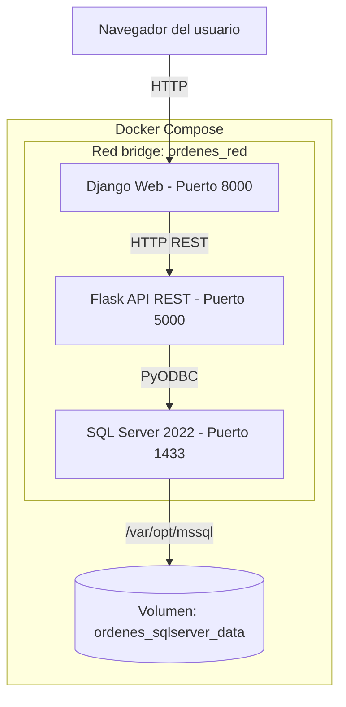

El navegador realiza las solicitudes al servidor Django.

Django recibe las solicitudes y las reenvía a la API
Flask mediante la dirección interna http://api:5000.

Flask procesa las operaciones y se comunica con SQL Server
mediante PyODBC.

Los tres contenedores están conectados mediante una red
personalizada de tipo bridge.

## 4. Servicios y puertos

| Servicio | Contenedor | Puerto |
|----------|------------|--------|
| SQL Server | ordenes_db | 1433 |
| Flask | ordenes_api | 5000 |
| Django | ordenes_web | 8000 |

## 5. Funcionalidades

### Gestión de órdenes

- Registrar órdenes.
- Consultar órdenes.
- Actualizar el estado de las órdenes.
- Eliminar órdenes.

### Gestión de detalles

- Agregar productos a una orden.
- Consultar los detalles de una orden.
- Editar el nombre, cantidad y precio de los productos.
- Eliminar productos.

### Funcionalidades adicionales

- Calcular subtotales automáticamente.
- Actualizar el total de cada orden.
- Mantener los datos mediante un volumen persistente.
- Comunicación interna entre los servicios.
- Comprobaciones de salud de los contenedores.
- Límites de consumo de CPU y memoria RAM.
- Ejecución de contenedores con usuarios sin privilegios root.
- Configuración mediante variables de entorno.

## 6. Endpoints de la API REST

| Método | Endpoint | Descripción |
|--------|----------|-------------|
| GET | /health | Estado de la API y base de datos |
| GET | /api/ordenes | Listar órdenes |
| GET | /api/ordenes/{id} | Consultar orden |
| POST | /api/ordenes | Crear orden |
| PUT | /api/ordenes/{id} | Actualizar orden |
| DELETE | /api/ordenes/{id} | Eliminar orden |
| GET | /api/ordenes/{id}/detalles | Consultar detalles |
| POST | /api/ordenes/{id}/detalles | Agregar detalle |
| PUT | /api/detalles/{id} | Actualizar detalle |
| DELETE | /api/detalles/{id} | Eliminar detalle |

## 7. Requisitos de instalación

- Docker Desktop.
- Docker Compose.
- Git.
- Navegador web.
- PowerShell.
- Recursos suficientes para ejecutar los tres contenedores.

No es necesario instalar Python, Flask, Django ni SQL Server
directamente en el equipo, ya que se ejecutan dentro de Docker.

## 8. Instrucciones de ejecución

Los siguientes comandos deben ejecutarse desde la carpeta
raíz del proyecto utilizando PowerShell.

Docker Desktop debe estar iniciado.

### 8.1. Variables de entorno

En una instalación nueva, crear el archivo .env utilizando
.env.example como referencia.

```powershell
Copy-Item .env.example .env
```

Abrir el archivo .env y configurar las siguientes variables:

```env
ACCEPT_EULA=Y
MSSQL_SA_PASSWORD=CAMBIAR_POR_TU_PASSWORD
MSSQL_PID=Developer

DJANGO_SECRET_KEY=CAMBIAR_POR_UNA_CLAVE_SECRETA
DJANGO_DEBUG=False
DJANGO_ALLOWED_HOSTS=localhost,127.0.0.1
```

Reemplazar los valores de ejemplo por una contraseña
segura para SQL Server y una clave secreta para Django.

La contraseña de SQL Server debe contener al menos ocho
caracteres y cumplir sus requisitos de complejidad.

La clave secreta de Django debe ser larga, aleatoria y privada.

El archivo .env contiene información confidencial y no
debe publicarse en GitHub.

Si el archivo .env ya existe, no sobrescribirlo.

### 8.2. Validar la configuración

```powershell
docker compose config --quiet
```

El comando debe finalizar sin errores ni advertencias.

### 8.3. Iniciar SQL Server

En una instalación nueva, iniciar primero el servicio
de base de datos.

```powershell
docker compose up -d db
```

Verificar su estado:

```powershell
docker compose ps
```

Esperar hasta que ordenes_db aparezca como healthy.

### 8.4. Inicializar la base de datos

Copiar el script SQL al contenedor:

```powershell
docker compose cp ./db/init.sql db:/tmp/init.sql
```

Ejecutar el script utilizando sqlcmd:

```powershell
docker compose exec db bash -c 'export SQLCMDPASSWORD=$MSSQL_SA_PASSWORD; /opt/mssql-tools18/bin/sqlcmd -S localhost -U sa -C -b -i /tmp/init.sql'
```

El script realiza las siguientes operaciones:

- Crea la base de datos OrdenesDB si no existe.
- Crea la tabla ordenes.
- Crea la tabla orden_detalle.
- Define las claves primarias y foráneas.
- Define las restricciones de integridad.
- Inserta cinco órdenes de prueba.
- Inserta diez detalles de prueba.
- Verifica los totales de las órdenes.

Este procedimiento está destinado a la instalación inicial.

No es necesario volver a inicializar la base de datos
cuando el volumen persistente ya contiene la información.

### 8.5. Construir e iniciar todos los servicios

```powershell
docker compose up -d --build
```

Docker Compose construirá las imágenes de Flask y Django
e iniciará los servicios correspondientes.

### 8.6. Verificar los contenedores

```powershell
docker compose ps
```

Los tres contenedores deben encontrarse activos y
en estado healthy.

### 8.7. Acceder a la aplicación

Interfaz web:

http://localhost:8000

Estado de la API:

http://localhost:5000/health

Consulta de órdenes mediante Django:

http://localhost:8000/api/ordenes

### 8.8. Verificar la comunicación entre servicios

```powershell
Invoke-RestMethod -Uri "http://localhost:5000/health"
```

```powershell
Invoke-RestMethod -Uri "http://localhost:8000/api/ordenes"
```

La primera solicitud verifica la conexión de Flask con
SQL Server.

La segunda solicitud verifica la comunicación entre
Django, Flask y SQL Server.

### 8.9. Consultar los registros

```powershell
docker compose logs --tail=50 api
```

```powershell
docker compose logs --tail=50 web
```

```powershell
docker compose logs --tail=50 db
```

### 8.10. Detener el sistema

```powershell
docker compose stop
```

### 8.11. Iniciar nuevamente el sistema

```powershell
docker compose start
```

### 8.12. Eliminar y recrear los contenedores

```powershell
docker compose down
docker compose up -d
```

No utilizar docker compose down -v si se desea conservar
la información almacenada en SQL Server.

## 9. Red y almacenamiento

### Red personalizada

- Nombre: ordenes_red.
- Tipo: bridge.

La red permite la comunicación interna mediante
los nombres de los servicios de Docker Compose.

Para verificar la red:

```powershell
docker network inspect ordenes_red
```

### Volumen persistente

- Nombre: ordenes_sqlserver_data.
- Ruta interna: /var/opt/mssql.

El volumen permite conservar los registros de SQL Server
aunque los contenedores sean eliminados y recreados.

Para verificar el volumen:

```powershell
docker volume ls
```

```powershell
docker volume inspect ordenes_sqlserver_data
```

## 10. Prueba de persistencia

Se realizaron las siguientes operaciones:

```powershell
docker compose down
docker volume ls
docker compose up -d
docker compose ps
```

Después de recrear los contenedores, se comprobó
que las órdenes y sus detalles continuaban almacenados.

El comando docker compose down se ejecutó sin la
opción -v para conservar el volumen de datos.

## 11. Consumo y límites de recursos

### 11.1. Límites configurados

| Contenedor | Límite CPU | Límite RAM |
|------------|------------|------------|
| SQL Server | 2 CPU | 3 GiB |
| Flask | 0.5 CPU | 256 MiB |
| Django | 0.5 CPU | 512 MiB |

Los límites se encuentran definidos en compose.yaml.

### 11.2. Consumo observado

Resultados obtenidos mediante:

```powershell
docker stats --no-stream
```

| Contenedor | CPU utilizada | Memoria utilizada | Límite RAM |
|------------|---------------|-------------------|------------|
| SQL Server | 2.62% | 686.9 MiB | 3 GiB |
| Flask | 0.03% | 23.33 MiB | 256 MiB |
| Django | 1.05% | 64.5 MiB | 512 MiB |

Los valores corresponden a una medición puntual
realizada después de configurar los límites.

### 11.3. Healthchecks

Los tres servicios cuentan con comprobaciones
de salud configuradas mediante Docker Compose.

| Servicio | Estado verificado |
|----------|-------------------|
| SQL Server | Healthy |
| Flask | Healthy |
| Django | Healthy |

## 12. Seguridad

### 12.1. Usuarios de los contenedores

Los servicios se ejecutan utilizando usuarios sin
privilegios root dentro de los contenedores.

| Servicio | Usuario |
|----------|---------|
| SQL Server | mssql |
| Flask | appuser |
| Django | appuser |

Los Dockerfile de Flask y Django incluyen la creación
y configuración del usuario appuser.

Para verificar los usuarios:

```powershell
docker compose exec db whoami
docker compose exec api whoami
docker compose exec web whoami
```

### 12.2. Seguridad de Django

Django utiliza variables de entorno para configurar
su clave secreta, modo de depuración y hosts permitidos.

Configuración verificada:

- DEBUG: False.
- ALLOWED_HOSTS: localhost y 127.0.0.1.
- SECRET_KEY: configurada mediante variables de entorno.

Para verificar la configuración sin mostrar la clave:

```powershell
docker compose exec web python manage.py shell -c "from django.conf import settings; print('DEBUG:', settings.DEBUG); print('ALLOWED_HOSTS:', settings.ALLOWED_HOSTS); print('SECRET_KEY configurada:', bool(settings.SECRET_KEY))"
```

### 12.3. Protección de credenciales

- Las credenciales se almacenan en el archivo .env.
- El archivo .env está excluido mediante .gitignore.
- El archivo .env.example contiene valores de ejemplo.
- Las contraseñas reales no deben publicarse.

### 12.4. Alcance de seguridad

El sistema fue desarrollado con fines académicos
y está destinado a ejecutarse en un entorno local.

La conexión de Flask a SQL Server utiliza el usuario sa.

Para un entorno de producción se recomienda utilizar
un usuario de base de datos con permisos limitados,
autenticación, protección CSRF, HTTPS y servidores
de aplicaciones apropiados para producción.

## 13. Evidencias y pruebas

### 13.1. Pruebas CRUD

| Operación | Resultado |
|-----------|-----------|
| Crear orden | Exitosa |
| Consultar órdenes | Exitosa |
| Actualizar estado de orden | Exitosa |
| Eliminar orden | Exitosa |
| Agregar producto | Exitosa |
| Consultar detalles | Exitosa |
| Actualizar producto | Exitosa |
| Eliminar producto | Exitosa |

Las ocho operaciones fueron verificadas desde
la interfaz web utilizando Django, Flask y SQL Server.

### 13.2. Archivos de evidencia

Las evidencias se encuentran en la carpeta evidencias.

| Archivo | Descripción |
|---------|-------------|
| consumo_recursos.txt | Consumo inicial de recursos |
| limites_recursos.txt | Verificación de límites CPU y RAM |
| persistencia.txt | Prueba de persistencia de datos |
| crud_funcionamiento.txt | Registros de funcionamiento de Flask y Django |
| seguridad.txt | Usuarios sin privilegios y configuración de seguridad |

### 13.3. Capturas de pantalla

#### Evidencia 1. Interfaz principal del sistema

Vista general de la aplicación web desarrollada con Django.

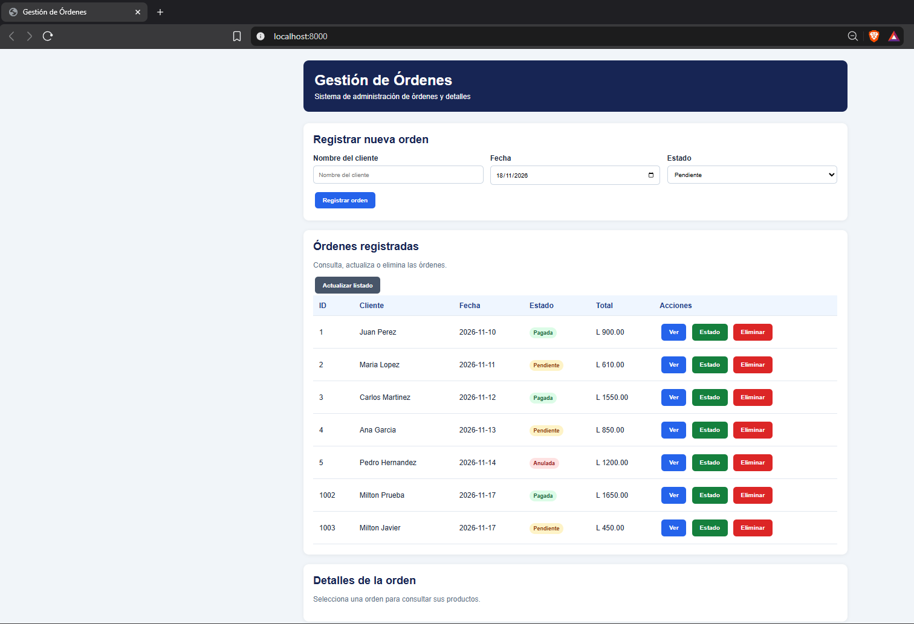

#### Evidencia 2. Creación de una orden

Registro de una nueva orden mediante la interfaz web.

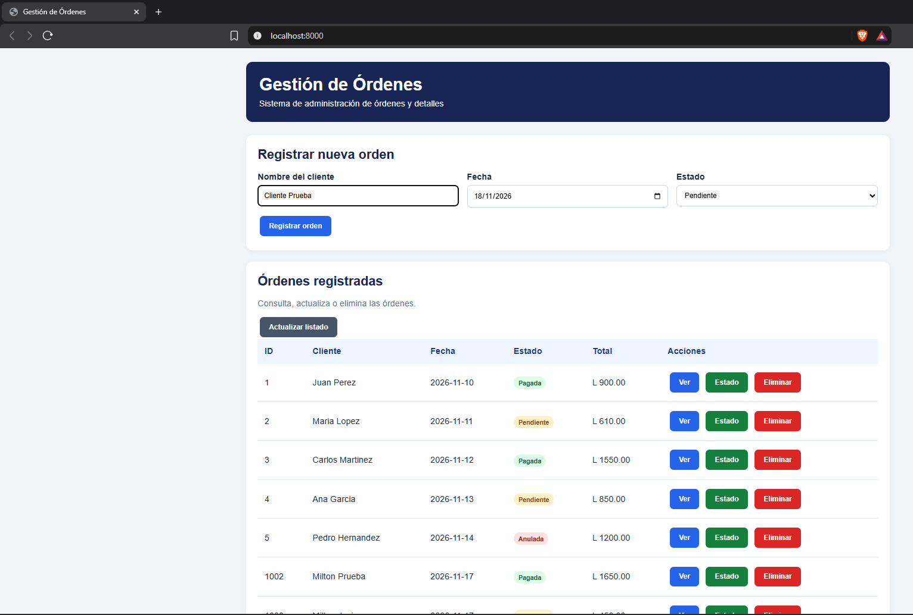

#### Evidencia 3. Detalles de una orden

Registro de productos y cálculo automático de subtotales
y del total de la orden.

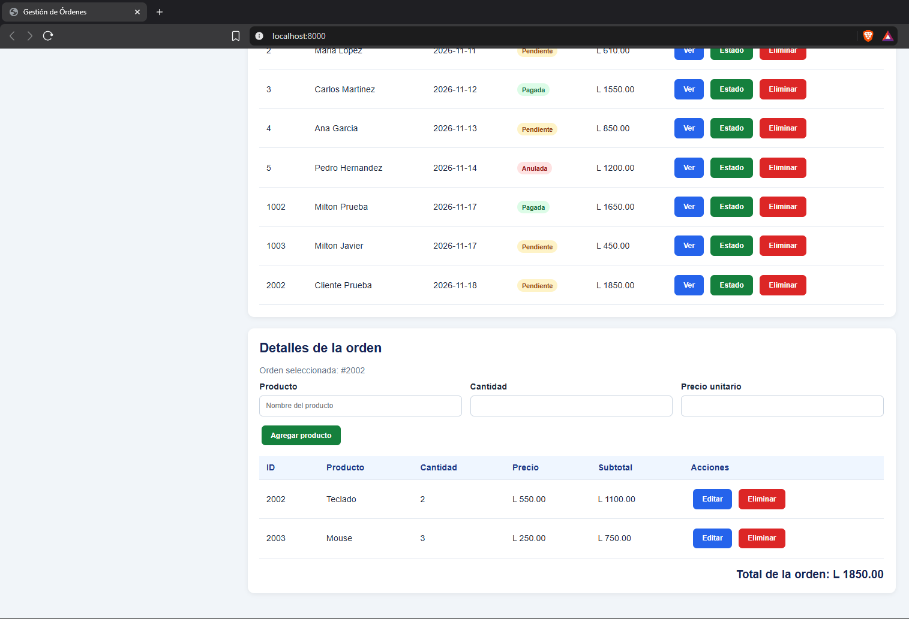

#### Evidencia 4. Edición de un producto

Actualización de la cantidad de un producto y recálculo
automático del total de la orden.


#### Evidencia 5. Eliminación de un producto

Eliminación de un producto y actualización del total
de la orden.

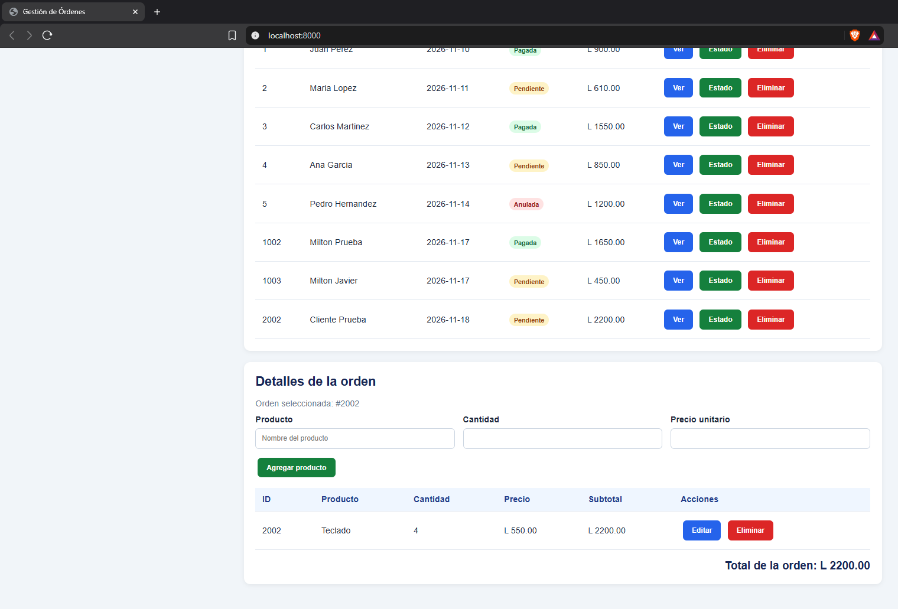

#### Evidencia 6. Funcionamiento de la API REST

Consulta de órdenes en formato JSON mediante la API
REST desarrollada con Flask.

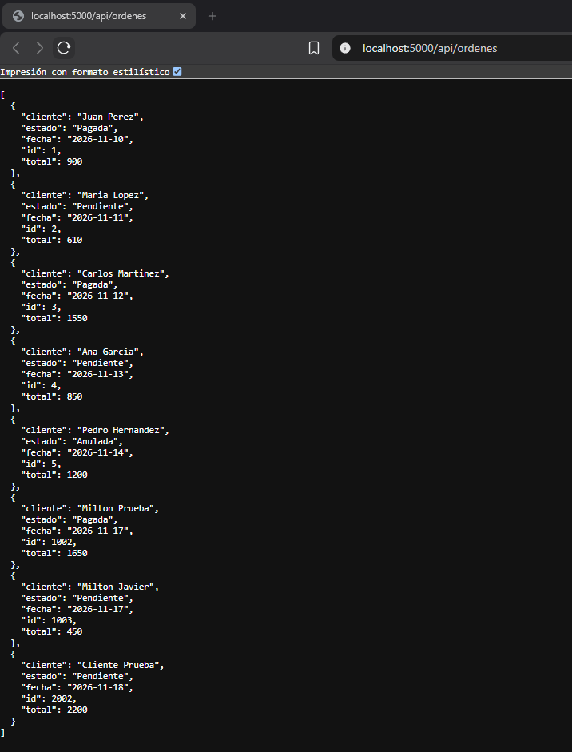

#### Evidencia 7. Estado de los contenedores

Verificación de los tres contenedores activos y en
estado healthy mediante Docker Compose.

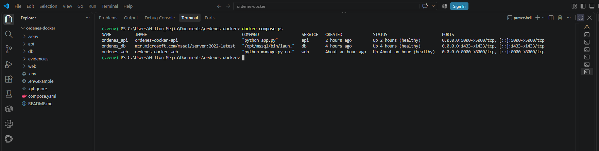

#### Evidencia 8. Consumo de recursos

Medición del consumo de CPU y memoria RAM mediante
el comando docker stats --no-stream.

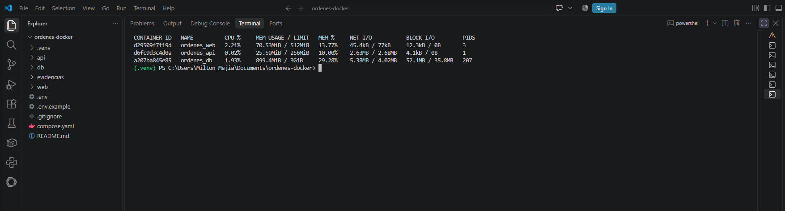

#### Evidencia 9. Persistencia de datos

Comprobación de que la información permanece almacenada
después de eliminar y recrear los contenedores,
utilizando un volumen persistente de Docker.

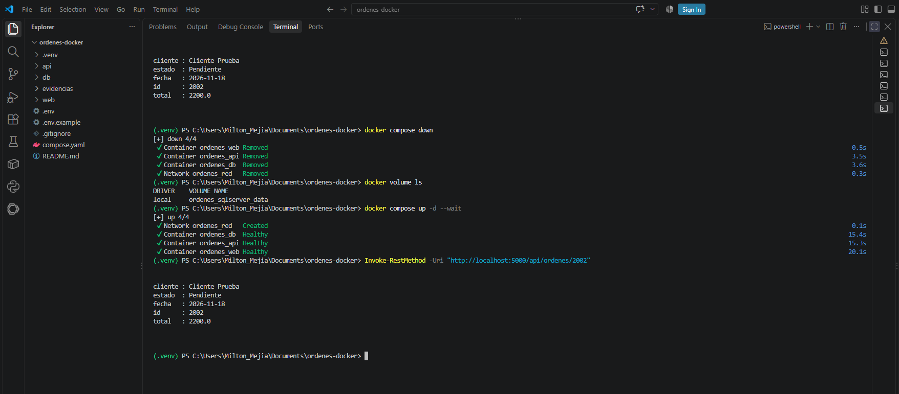

#### Evidencia 10. Seguridad de los contenedores

Verificación de usuarios sin privilegios root y de
la configuración de seguridad de Django sin revelar
las credenciales.

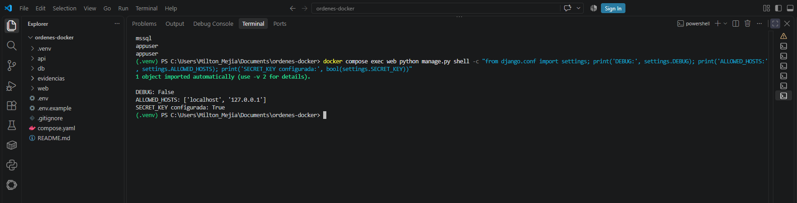

#### Evidencia 11. Pruebas de la API REST con curl

Verificación de la API REST mediante curl, comprobando
la conexión con SQL Server, la consulta de una orden
existente y el manejo de una orden inexistente.

| Prueba | Código HTTP | Resultado |
|--------|-------------|-----------|
| GET /health | 200 OK | API y base de datos saludables |
| GET /api/ordenes/2002 | 200 OK | Orden encontrada |
| GET /api/ordenes/999999 | 404 NOT FOUND | Orden no encontrada |

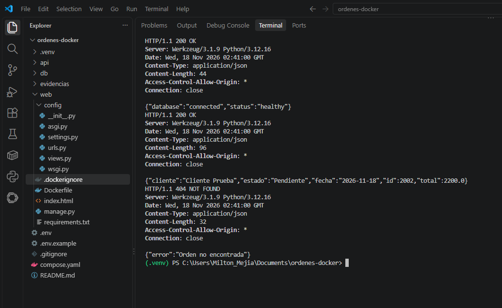

#### Evidencia 12. Edición completa de una orden

Se verifica la actualización del nombre del cliente,
la fecha y el estado de una orden, conservando su
total y los productos registrados.

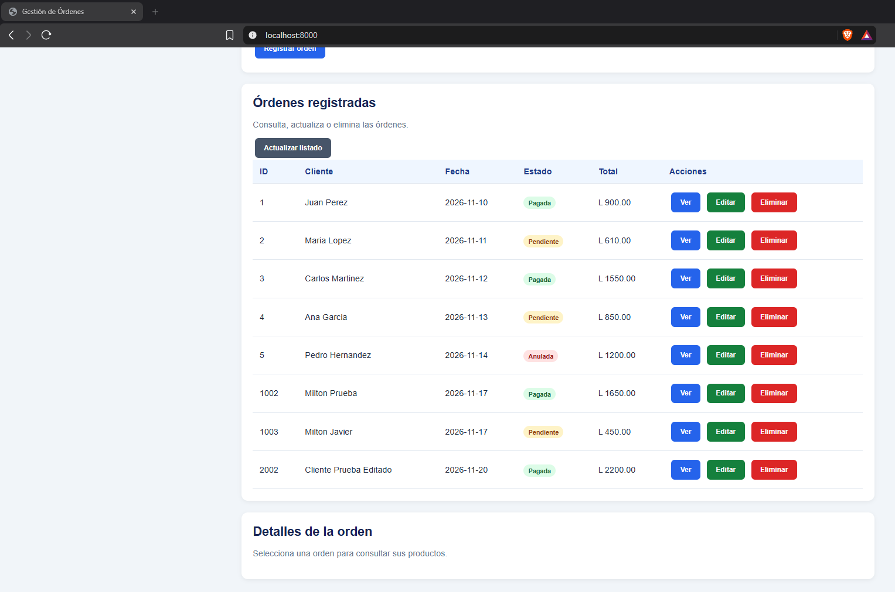

## 14. Estructura del proyecto

```text
ordenes-docker/
├── api/
│   ├── .dockerignore
│   ├── app.py
│   ├── Dockerfile
│   └── requirements.txt
├── db/
│   └── init.sql
├── evidencias/
│   ├── capturas/
│   │   ├── 01_interfaz_principal.png
│   │   ├── 02_crear_orden.png
│   │   ├── 03_detalles_orden.png
│   │   ├── 04_editar_producto.png
│   │   ├── 05_eliminar_producto.png
│   │   ├── 06_api_rest.png
│   │   ├── 07_contenedores.png
│   │   ├── 08_consumo_recursos.png
│   │   ├── 09_persistencia.png
│   │   ├── 10_seguridad.png
│   │   ├── 11_pruebas_api_curl.png
│   │   └── 12_editar_orden.png
│   ├── consumo_recursos.txt
│   ├── crud_funcionamiento.txt
│   ├── limites_recursos.txt
│   ├── persistencia.txt
│   └── seguridad.txt
├── web/
│   ├── config/
│   │   ├── __init__.py
│   │   ├── asgi.py
│   │   ├── settings.py
│   │   ├── urls.py
│   │   ├── views.py
│   │   └── wsgi.py
│   ├── .dockerignore
│   ├── Dockerfile
│   ├── index.html
│   ├── manage.py
│   └── requirements.txt
├── .env.example
├── .gitignore
├── compose.yaml
└── README.md
```

El archivo .env se genera localmente a partir de
.env.example y no se incluye en el repositorio
por motivos de seguridad.

El entorno virtual .venv y los archivos temporales
de Python tampoco se incluyen en el repositorio.

## 15. Repositorios

### 15.1. GitHub

Repositorio público que contiene el código fuente,
los archivos de configuración, la documentación
y las evidencias del proyecto.

https://github.com/milton97mejia-ux/ordenes-docker

### 15.2. Docker Hub - Flask API

Imagen de la API REST desarrollada con Flask.

- Imagen: stratodelux72/ordenes-api:v1.0
- Versión: v1.0
- Visibilidad: Pública

https://hub.docker.com/r/stratodelux72/ordenes-api

### 15.3. Docker Hub - Django Web

Imagen de la aplicación web desarrollada con Django.

- Imagen: stratodelux72/ordenes-web:v1.0
- Versión: v1.0
- Visibilidad: Pública

https://hub.docker.com/r/stratodelux72/ordenes-web

## 16. Integrante

- Nombre completo: Milton Javier Mejía Bardales.
- Número de cuenta: 202410011134.

## 17. Conclusiones

El proyecto demuestra la integración de una aplicación
web, una API REST y una base de datos relacional
mediante contenedores Docker.

Docker Compose facilita la administración de los
servicios, mientras que la red personalizada permite
la comunicación interna entre Django, Flask y SQL Server.

El volumen persistente garantiza la conservación de
los datos al recrear los contenedores.

La configuración de límites de CPU y memoria permite
controlar los recursos asignados a cada servicio.

Las comprobaciones de salud permiten verificar el
estado operativo de los contenedores.

La ejecución con usuarios sin privilegios root y el
uso de variables de entorno contribuyen a mejorar
la seguridad del sistema.

Finalmente, las pruebas realizadas permitieron comprobar
el funcionamiento de las operaciones CRUD de órdenes
y sus detalles.